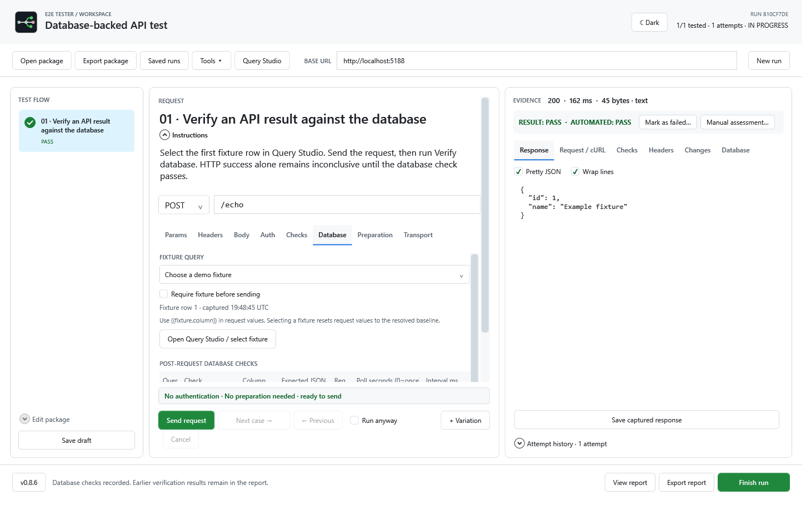
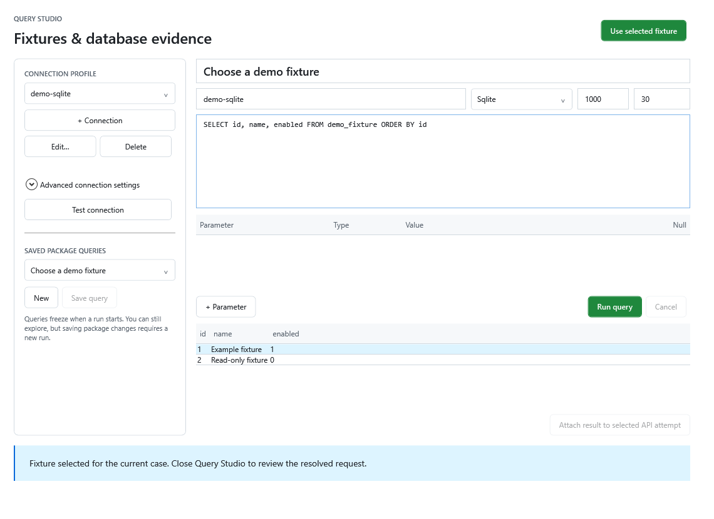

# E2E Tester

**Guided API testing for Windows.** Prepare reusable test packages, sign in, run requests one case at a time, and retain evidence for every attempt. Add a variation whenever you need to try something different, verify the effect in your database, and export a report that people and AI agents can both read.

MIT licensed · WPF / .NET 10 · Local-first · MCP support


Created by [d3sync](https://d3sync.org). Click the status-bar version, or Tools > About E2E Tester, for license and build details.

## How it works

1. **Open a package.** A `.jsee` file is plain JSON describing an ordered list of cases: request, identity, checks and optional database verification. Opening one never sends anything.
2. **Sign in.** Import a token through the embedded Swagger browser, paste a JWT/API token, or use a registered OIDC client. Each case names the identity it runs as.
3. **Run one case at a time.** Edit values before sending; changes are recorded against the original. Every send becomes an attempt with the prepared request, cURL with captured values, response and check results.
4. **Verify.** Optionally pick a fixture row in Query Studio and confirm the API's effect with a read-only query. A case stays INCONCLUSIVE until required checks finish.
5. **Finish and report.** Export JSON, HTML or a ZIP evidence bundle. Manual assessments sit beside automated verdicts.

## Try it

Use a published single-file executable or Velopack installer. Builds from `tools/Publish-*.ps1` are self-contained; the hosted update feed ships a smaller build that needs the [.NET 10 Desktop Runtime](https://dotnet.microsoft.com/download/dotnet/10.0). Requires Windows 10/11 x64; Swagger sign-in also needs the **Microsoft Edge WebView2 Runtime**.

From source, on Windows with the SDK in `global.json`:

```powershell
dotnet restore --locked-mode
./Start-Tester.ps1 -Demo
```

The local demo starts its own API. Send a request, review the result, edit a parameter, add a variation and continue. Finish the run to export a report. The demo does not contact external services.

For a generic cloud template, click **Cloud test** or double-click [cloud-checkremoteip.jsee](samples/generic/cloud-checkremoteip.jsee) ([JSON copy](samples/generic/cloud-checkremoteip.json)). Replace the placeholder URL and endpoint with your environment, then follow the [walkthrough](samples/generic/cloud-checkremoteip.md). This GET workflow needs **no database fixtures**. Authenticated results require your own account and permissions.

## Features

- Reusable `.jsee` test packages (UTF-8 JSON, opened by double-click) with instructions, defaults, assertions and editable cases. Plain `.json` import/export remains available.
- HTTP methods and multiple body formats; parameter/header toggles and deletion; prepared request evidence and cURL with captured values.
- Swagger sign-in, remembered browser state, JWT/API tokens, registered OIDC/PKCE and named identities.
- PASS, FAIL and INCONCLUSIVE results, attempt history, variations and manual assessments.
- Optional SQL Server, MySQL, PostgreSQL and SQLite fixtures/verification.
- JSON/HTML reports and evidence bundles for people and AI agents.
- MCP stdio tools, recovery, encrypted environments, backups and saved runs.
- Light/dark themes, compact Auth and optional Advanced database/transport controls.
- Single-file publishing and Velopack installation, version selection and rollback.

See [features and limits](docs/features.md). Loading a package never sends requests automatically. Reports retain captured values, including request headers, tokens and business data.

Tools > API workspace opens ad-hoc requests with OpenAPI JSON import. See the [workspace guide](docs/packages-and-playground.md).

## Screenshots

| Database-backed case | Query Studio |
| --- | --- |
|  |  |

## AI agents and MCP

**Tools → AI test generator** shows a copyable prompt, the package template and the bundled [agent skill](skills/e2e-tester-author/SKILL.md), and can export a setup kit. Agents can draft `.jsee` suites from an API description; you review and run them in the desktop.

`E2ETester.Mcp.exe` is a local stdio [MCP](https://modelcontextprotocol.io) server sharing the desktop's execution engine. Its 23 tools cover packages, runs, sending prepared requests, database verification, assessments and reports. Read-only inspection tools are always available; HTTP execution, authoring, saved SQL, interactive login and preparation each stay disabled until the host configuration enables them. Targets are allowlisted, SQL must match an approved definition exactly, and tokens come only from the server's environment. See [MCP configuration](docs/mcp.md) and [agent setup](docs/agent-authoring.md).

## Documentation

| User guides | Technical guides |
| --- | --- |
| [HTTP workflow](docs/http-workflow.md) | [Architecture](docs/architecture.md) |
| [Swagger and diagnostics](docs/swagger-diagnostics-themes.md) | [MCP configuration](docs/mcp.md) |
| [Authentication](docs/authentication.md) | [Testing](docs/testing.md) |
| [Database workflow](docs/database-workflow.md) | [Updates and rollback](docs/updates.md) |
| [Connection wizard and preparation](docs/preparation-and-connections.md) | [Preparation example](samples/generic/prepared-permissions.json) |
| [Reports](docs/reports.md) | [Schemas](schemas) |
| [Workspace and recovery](docs/workspace.md) | [Implementation status](docs/implementation-status.md) |
| [Brand kit](assets/branding/README.md) | [Changelog](CHANGELOG.md) |

## Build, test and package

```powershell
dotnet build --configuration Release
dotnet run --project tests/E2ETester.IntegrationTests --configuration Release --no-build
python tools/test_mcp.py
./tools/Publish-Windows.ps1
./tools/Publish-Installer.ps1
```

The first publish script creates one self-contained executable per host plus docs/samples. The second creates Velopack setup and update assets. Official builds check the maintainer's feed for updates but never download or install without confirmation; forks should point the default feed at their own host (see [updates](docs/updates.md)). Builds are currently unsigned. Keep older full packages in the feed to make them selectable for rollback.

## Contribute

Read [CONTRIBUTING.md](CONTRIBUTING.md), [CODE_OF_CONDUCT.md](CODE_OF_CONDUCT.md) and [SECURITY.md](SECURITY.md). Use synthetic reproductions and never attach credentials or private browser profiles.

[MIT license](LICENSE). Dependencies retain their own licenses: [third-party notices](THIRD_PARTY_NOTICES.md). Artwork provenance is in the brand kit. Historical `docs/plan` files describe design intent, not the current feature reference.
