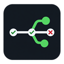
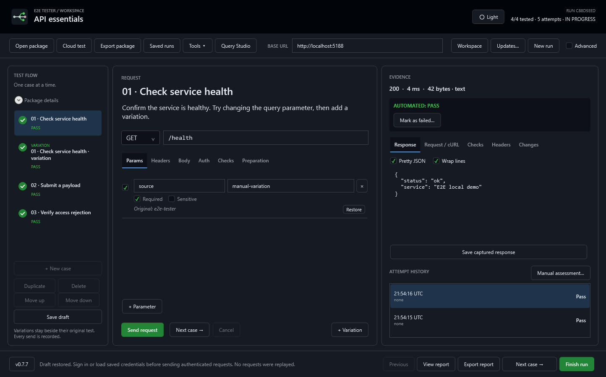

# E2E Tester

**Guided API testing for Windows.** Prepare reusable test packages, sign in, run requests one case at a time, and retain evidence for every attempt. Add a variation whenever you need to try something different.

MIT licensed · WPF / .NET 10 · Local-first · MCP support



Created by [d3sync](https://d3sync.org). Click the status-bar version, or Tools > About E2E Tester, for license and build details.

## Try it

Use a published single-file executable or Velopack installer. No separate .NET runtime is needed. Swagger sign-in requires **Microsoft Edge WebView2 Runtime**.

From source, on Windows with the SDK in `global.json`:

```powershell
dotnet restore --locked-mode
./Start-Tester.ps1 -Demo
```

The local demo starts its own API. Send a request, review the result, edit a parameter, add a variation and continue. Finish the run to export a report. The demo does not contact external services.

For a generic cloud template, click **Cloud test** or open [cloud-checkremoteip.json](samples/generic/cloud-checkremoteip.json). Replace the placeholder URL and endpoint with your environment, then follow the [walkthrough](samples/generic/cloud-checkremoteip.md). This GET workflow needs **no database fixtures**. Authenticated results require your own account and permissions.

## Features

- Reusable JSON packages, instructions, defaults, assertions and editable cases.
- HTTP methods and multiple body formats; parameter/header toggles and deletion; prepared request evidence and redacted cURL.
- Swagger sign-in, remembered browser state, JWT/API tokens, registered OIDC/PKCE and named identities.
- PASS, FAIL and INCONCLUSIVE results, attempt history, variations and manual assessments.
- Optional SQL Server, MySQL, PostgreSQL and SQLite fixtures/verification.
- JSON/HTML reports and evidence bundles for people and AI agents.
- MCP stdio tools, recovery, encrypted environments, backups and saved runs.
- Light/dark themes, compact Auth and optional Advanced database/transport controls.
- Single-file publishing and Velopack installation, version selection and rollback.

See [features and limits](docs/features.md). Loading a package never sends requests automatically. Reports can contain business data even after credential redaction.

Tools > API workspace opens ad-hoc requests with OpenAPI JSON import. Tools > AI test generator provides the prompt and template. See [workspace guide](docs/packages-and-playground.md) and [agent setup](docs/agent-authoring.md).

## Documentation

| User guides | Technical guides |
| --- | --- |
| [HTTP workflow](docs/http-workflow.md) | [Architecture](docs/architecture.md) |
| [Swagger and diagnostics](docs/swagger-diagnostics-themes.md) | [MCP configuration](docs/mcp.md) |
| [Authentication](docs/authentication.md) | [Testing](docs/testing.md) |
| [Database workflow](docs/database-workflow.md) | [Updates and rollback](docs/updates.md) |
| [Reports](docs/reports.md) | [Schemas](schemas) |
| [Workspace and recovery](docs/workspace.md) | [Implementation status](docs/implementation-status.md) |
| [Brand kit](assets/branding/README.md) | [Changelog](CHANGELOG.md) |

## Build, test and package

```powershell
dotnet build --configuration Release
dotnet run --project tests/E2ETester.IntegrationTests --configuration Release --no-build
python tools/test_mcp.py
./tools/Publish-Windows.ps1
./tools/Publish-Installer.ps1
```

The first publish script creates one self-contained executable per host plus docs/samples. The second creates Velopack setup and update assets. Feed hosting and signing are configured by maintainers; no public update URL or automatic background installation is assumed. Keep older full packages in the feed to make them selectable for rollback.

## Contribute

Read [CONTRIBUTING.md](CONTRIBUTING.md), [CODE_OF_CONDUCT.md](CODE_OF_CONDUCT.md) and [SECURITY.md](SECURITY.md). Use synthetic reproductions and never attach credentials or private browser profiles.

[MIT license](LICENSE). Dependencies retain their own licenses: [third-party notices](THIRD_PARTY_NOTICES.md). Artwork provenance is in the brand kit. Historical `docs/plan` files describe design intent, not the current feature reference.
