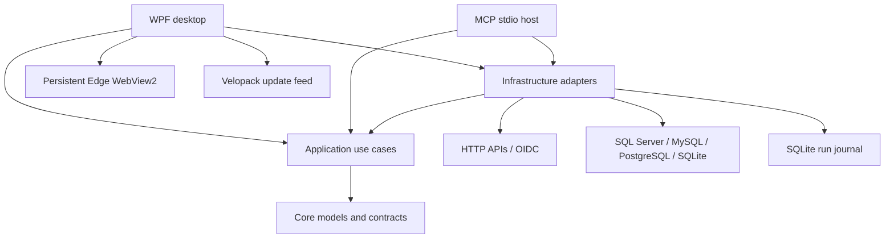

# Architecture

E2E Tester is a local-first Windows application with a WPF desktop host and a separate stdio MCP host. Both use the same domain/use-case libraries. There is no hosted service or telemetry backend in the application.

| Project/directory | Responsibility |
| --- | --- |
| `src/E2ETester.Core` | Package, request, assertion, identity, attempt, database and report models |
| `src/E2ETester.Application` | Validation, request resolution, run coordination, assertions, reports, evidence policy |
| `src/E2ETester.Infrastructure` | HttpClient transport, SQL providers, SQLite journal, Windows secret protection and OIDC adapter |
| `src/E2ETester.Desktop` | WPF editors, guided navigation, WebView2 Swagger import, themes, recovery/exit UX and updates |
| `src/E2ETester.Mcp` | MCP tool registration, configuration and permission boundary, execution idempotency |
| `tests/E2ETester.IntegrationTests` | Executable integration harness with synthetic services and optional live database checks |
| `schemas`, `samples` | Interchange contracts and runnable example packages |
| `tools` | Publishing, browser/protocol verification, schema generation and artwork export |

## Request lifecycle

An editor keeps the imported baseline alongside current values. The coordinator resolves fixtures and earlier-response bindings, validates the request, and journals an attempt before network I/O. The transport records the prepared method, URL, headers and body, including redirect hops. Assertions evaluate the captured response. Captured evidence and the outcome are persisted; later edits do not rewrite earlier attempts.

Each attempt is PASS, FAIL or INCONCLUSIVE. Required database verification can leave a successful HTTP exchange inconclusive until the data check finishes. The latest attempt per case determines automated coverage; historical failures remain visible. Manual assessments accompany automated results and are tied to an evidence hash.

Fixtures are optional data inputs, not a GET requirement. A package's `fixtureRequired` flag creates a selection prerequisite; a saved query alone can remain optional. The local database demo uses it; the cloud checkremoteip package does not. Changing a URL never silently removes declared database checks.

## Data and identity

Workspace journals and drafts live under `%LOCALAPPDATA%/E2ETester/Workspaces` by default. A process lock prevents concurrent writers to one workspace. Interrupted requests are recovered as uncertain evidence rather than replayed. Recovery drafts retain all entered values; explicit save state is separate from automatic recovery writes.

Manual JWT/API tokens can be saved explicitly in Windows-protected environment files. Native OIDC uses PKCE and validated identity tokens; refresh sessions stay in memory. Swagger token import uses a persistent WebView2 profile keyed by origin and identity alias. OAuth popups share that profile/environment and retain their opener. Web authentication and API bearer lifetime are separate.

## Extension points

Add assertions in Core/Application, database adapters in Infrastructure, and expose the same behavior through Desktop/MCP where appropriate. Extend schema files and fixtures with contract changes. Avoid placing authorization or outcome rules only in UI controls.

Velopack operates before WPF initialization. Update checks are user-triggered. The installed desktop can select an exact full package from a trusted feed; a lower version is an explicit downgrade. Before applying, the app saves its draft and backs up the workspace. Application rollback does not downgrade database schema or restore user data automatically.

The historical design notes remain under `docs/plan`; they describe intent and may include deferred ideas. This document describes the current implementation. See [feature overview](features.md) and [testing](testing.md).

The `E2ETester.Cli` host uses `HeadlessRunner` and `AgentWorkspace` for unattended execution with the same permissions and persistence as MCP. It writes JUnit plus canonical reports. OpenAPI/Postman import and offline JSON Schema evaluation live in Application; the desktop and CLI share them.
